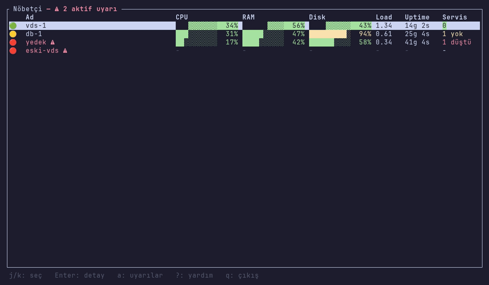

<div align="center">

# 🛡️ Nöbetçi

**Birden fazla Linux sunucusunu tek terminal ekranından izle. Agent kurmana gerek yok, sadece SSH yeter.**

[](https://www.rust-lang.org/)
[](LICENSE)
[](../../actions)



</div>

---

## Nedir?

Nöbetçi, Rust ile yazılmış bir terminal arayüzü (TUI). VDS ve VPS sunucularına **SSH üzerinden** bağlanır ve şu bilgileri tek panoda gösterir:

- CPU, RAM, swap, disk ve ağ kullanımı
- systemd servislerinin durumu
- canlı `journalctl` logları

Sunuculara hiçbir şey kurman gerekmez. Bilgiler doğrudan `/proc` ve standart araçlardan okunur.

Bir servis çöktüğünde, disk dolmak üzereyken ya da sunucu erişilemez olduğunda **Discord** veya **Telegram** üzerinden bildirim gönderir. TUI açık olmasa da bildirimler gelir, çünkü Nöbetçi arka planda `daemon` modunda da çalışabilir.

## Özellikler

| | |
|---|---|
| 🔌 **Agent'sız** | Sadece SSH. Var olan `~/.ssh/config` girdilerini okur. |
| 📊 **Canlı metrikler** | CPU (çekirdek bazında), RAM, swap, load, disk, ağ trafiği ve sparkline geçmişi |
| ⚙️ **Servis takibi** | İzlemek istediğin systemd servisleri, tek tuşla restart (onaylı) |
| 📜 **Log görüntüleyici** | Canlı `journalctl -f`, arama (`n`/`N`, vurgulu) ve süzme (`f`) |
| 🚨 **Uyarılar** | Eşik kuralları (ör. `disk > 90%` 5 dk boyunca), servis düştü, sunucu erişilemez |
| 🔔 **Bildirimler** | Discord webhook ve Telegram bot, ikisi birlikte de kullanılabilir |
| 🌙 **Daemon modu** | TUI olmadan arka planda izleme ve bildirim, systemd unit dosyası dahil |
| ⚡ **Hafif** | Tek binary, async (tokio), düşük CPU ve bellek kullanımı |

## Ekran görüntüleri

| Genel bakış | Sunucu detayı | Loglar |
|---|---|---|
|  |  |  |

## Kurulum

```bash
# crates.io
cargo install nobetci

# veya kaynaktan
git clone https://github.com/KULLANICI/nobetci
cd nobetci
cargo build --release
```

Arch / CachyOS için AUR paketi planlanıyor: `nobetci-bin`.

## Hızlı başlangıç

```bash
nobetci init      # örnek config dosyasını oluşturur
nobetci           # TUI'yi açar
nobetci daemon    # arka planda izler ve bildirim gönderir
nobetci check --test-notify   # config'i, bağlantıları ve bildirim kanallarını dener
```

TUI de uyarı kurallarını çalıştırır (Uyarılar ekranı) ama bildirim göndermez; bildirimleri yalnızca `daemon` gönderir, böylece ikisi birlikte açıkken çift mesaj gitmez.

Config dosyası `~/.config/nobetci/config.toml` konumundadır:

```toml
[[server]]
name = "vds-1"
ssh_host = "vds1"            # ~/.ssh/config içindeki Host adı
services = ["nginx", "minecraft", "postgresql"]

[[server]]
name = "yedek"
host = "203.0.113.10"
user = "root"
port = 22
key = "~/.ssh/id_ed25519"

[notify.discord]
webhook_url = "https://discord.com/api/webhooks/..."

[notify.telegram]
bot_token = "..."
chat_id = "..."

[[alert]]
when = "disk_usage > 90"
for = "5m"
servers = ["*"]

[[alert]]
when = "service_down"
servers = ["vds-1"]
```

## Kısayollar

| Tuş | İşlev |
|---|---|
| `↑ ↓` / `j k` | Sunucu seç (servis ve log listesinde gezinme) |
| `Enter` | Detay görünümü |
| `Esc` | Geri / kapat |
| `s` | Detayda servis listesine odaklan |
| `r` | Seçili servisi yeniden başlat (onay ister, `allow_actions = true` gerekir) |
| `a` | Uyarılar: aktif ve geçmiş (`j`/`k` kaydır, `Esc` geri) |
| `l` | Loglar (seçili servis ya da tüm günlük) |
| `/` | Log araması: eşleşmeler vurgulanır (`Enter` uygula, `Esc` temizle) |
| `n` / `N` | Sonraki / önceki eşleşme (uçlarda sarar, takipten çıkar) |
| `f` | Yalnızca eşleşen satırları göster / tümünü göster |
| `g` / `G` | Log başı / sonu (`G` canlı takibe döner) |
| `PgUp` / `PgDn` | Log sayfa kaydır |
| `?` | Yardım |
| `q` | Çıkış |

## Güvenlik

- Şifreler config dosyasında tutulmaz. Kimlik doğrulama SSH anahtarı veya `ssh-agent` ile yapılır.
- Bilinmeyen host anahtarları `known_hosts` dosyasıyla doğrulanır, sessizce kabul edilmez.
- Servis yeniden başlatma gibi yazma işlemleri varsayılan olarak kapalıdır ve config'te `allow_actions = true` ile açılır.

## Yol haritası

- [ ] Docker container listesi ve durumu
- [ ] Uptime geçmişi ve basit SLA raporu
- [ ] Prometheus `/metrics` çıktısı
- [ ] Tema desteği
- [ ] Sunucu grupları ve etiketler

## Katkı

PR'lar açık. Büyük bir değişiklik düşünüyorsan önce bir issue aç.

## Lisans

MIT
