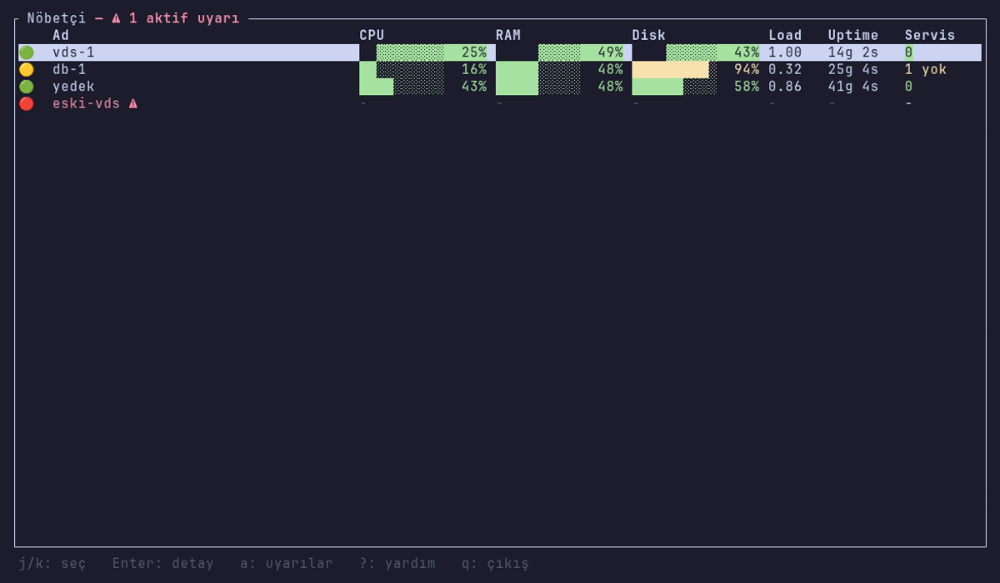
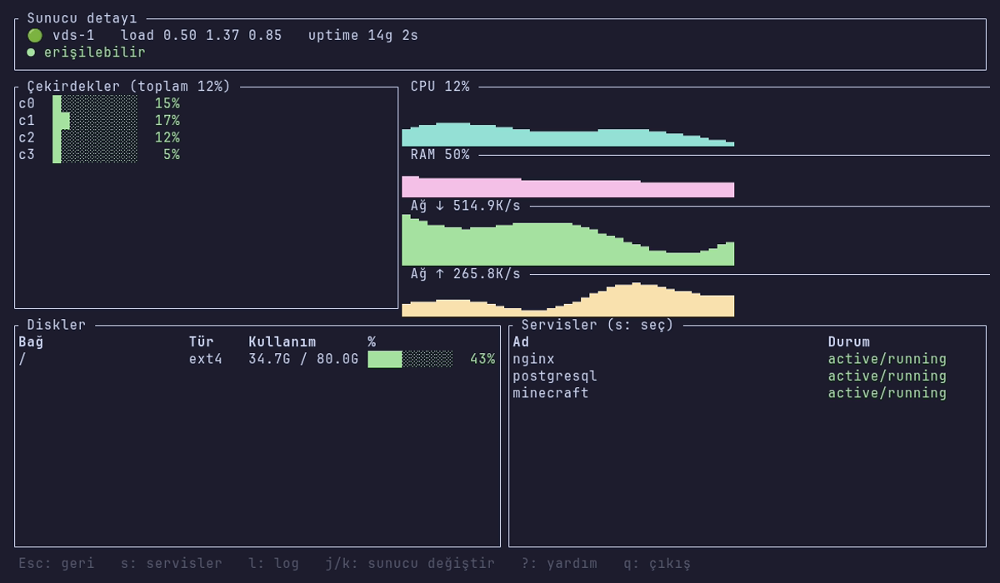
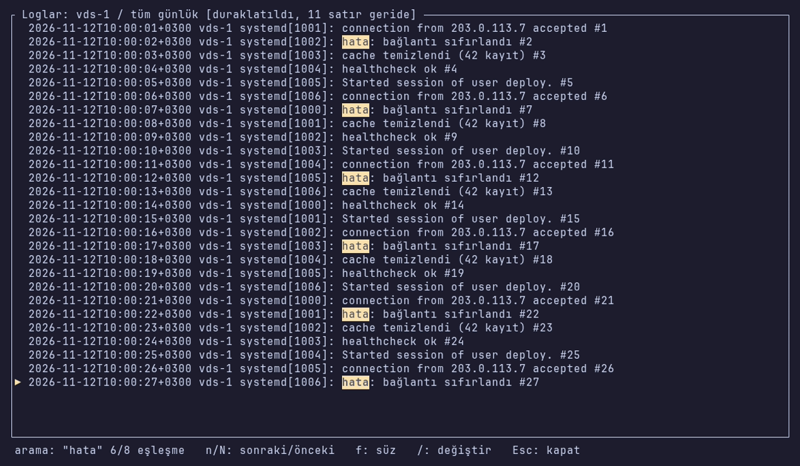
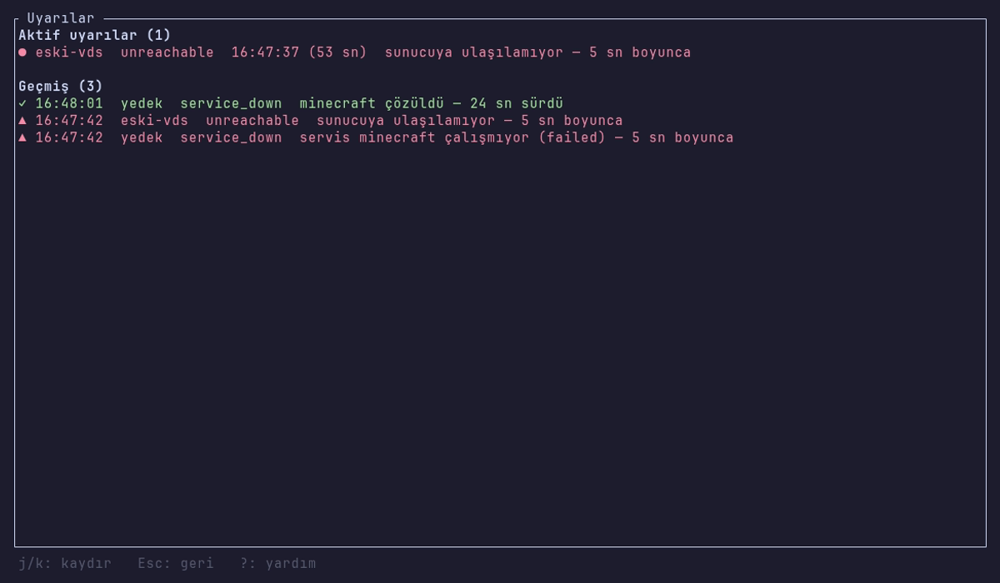

<div align="center">

# 🛡️ Nöbetçi

**Birden fazla Linux sunucusunu tek terminal ekranından izle. Agent kurmana gerek yok, sadece SSH yeter.**

[](https://github.com/Shidori5417/nobetci/actions/workflows/ci.yml)
[](https://github.com/Shidori5417/nobetci/releases/latest)
[](LICENSE)
[](https://www.rust-lang.org/)


</div>

---

## Nedir?

Nöbetçi, Rust ile yazılmış bir terminal arayüzü (TUI). VDS ve VPS sunucularına **SSH üzerinden** bağlanır ve şu bilgileri tek panoda gösterir:

- CPU, RAM, swap, disk ve ağ kullanımı
- systemd servislerinin durumu
- canlı `journalctl` logları

Sunuculara hiçbir şey kurman gerekmez. Bilgiler doğrudan `/proc` ve standart araçlardan okunur.

Bir servis çöktüğünde, disk dolmak üzereyken ya da sunucu erişilemez olduğunda **Discord** veya **Telegram** üzerinden bildirim gönderir. TUI açık olmasa da bildirimler gelir, çünkü Nöbetçi arka planda `daemon` modunda da çalışabilir.

## Özellikler

| | |
|---|---|
| 🔌 **Agent'sız** | Sadece SSH. Var olan `~/.ssh/config` girdilerini okur. |
| 📊 **Canlı metrikler** | CPU (çekirdek bazında), RAM, swap, load, disk, ağ trafiği ve sparkline geçmişi |
| ⚙️ **Servis takibi** | İzlemek istediğin systemd servisleri, tek tuşla restart (onaylı) |
| 📜 **Log görüntüleyici** | Canlı `journalctl -f`, arama (`n`/`N`, vurgulu) ve süzme (`f`) |
| 🚨 **Uyarılar** | Eşik kuralları (ör. `disk > 90%` 5 dk boyunca), servis düştü, sunucu erişilemez |
| 🔔 **Bildirimler** | Discord webhook ve Telegram bot, ikisi birlikte de kullanılabilir |
| 🌙 **Daemon modu** | TUI olmadan arka planda izleme ve bildirim, systemd unit dosyası dahil |
| ⚡ **Hafif** | Tek binary, async (tokio), düşük CPU ve bellek kullanımı |

## Ekran görüntüleri

| Genel bakış | Sunucu detayı | Loglar | Uyarılar |
|---|---|---|---|
|  |  |  |  |

## Kurulum

```bash
# Kaynaktan (GitHub)
cargo install --git https://github.com/Shidori5417/nobetci

# veya depoyu klonlayıp
git clone https://github.com/Shidori5417/nobetci
cd nobetci
cargo build --release   # çıktı: target/release/nobetci
```

Linux x86_64 ve aarch64 için hazır derlenmiş paketler [GitHub Releases](https://github.com/Shidori5417/nobetci/releases/latest) sayfasında yayınlanır (ör. `nobetci-v0.1.0-x86_64-unknown-linux-gnu.tar.gz`). Gereken en düşük Rust sürümü 1.85'tir (edition 2024).

## Hızlı başlangıç

```bash
nobetci init                  # örnek config dosyasını oluşturur (var olanı korur; --force ile üzerine yazar)
nobetci                       # TUI'yi açar
nobetci daemon                # TUI'siz izler ve bildirim gönderir
nobetci check                 # config'i doğrular, sunuculara bağlanmayı dener
nobetci check --test-notify   # ayrıca her bildirim kanalına test mesajı yollar
nobetci --demo                # sahte veriyle dener, config ve sunucu gerekmez
nobetci --config yol.toml     # varsayılan yerine başka bir config dosyası kullanır
```

`--demo` ve `--config` her alt komutla birlikte kullanılabilir. TUI de uyarı kurallarını çalıştırır (Uyarılar ekranı) ama bildirim göndermez; bildirimleri yalnızca `daemon` gönderir, böylece ikisi birlikte açıkken çift mesaj gitmez.

Config dosyası varsayılan olarak `~/.config/nobetci/config.toml` konumundadır. Tüm anahtarların açıklamalı hali için [`config.example.toml`](config.example.toml) dosyasına bak.

```toml
interval = "2s"              # örnekleme aralığı (isteğe bağlı, varsayılan 2s, en az 1s)

[[server]]
name = "vds-1"
ssh_host = "vds1"            # ~/.ssh/config içindeki Host adı
services = ["nginx", "minecraft", "postgresql"]
allow_actions = false        # true: 'r' ile servis restart açılır (varsayılan kapalı)

[[server]]
name = "yedek"
host = "203.0.113.10"
user = "root"
port = 22
key = "~/.ssh/id_ed25519"

[notify.discord]
webhook_url = "https://discord.com/api/webhooks/..."

[notify.telegram]
bot_token = "..."
chat_id = "..."

[[alert]]
when = "disk_usage > 90"
for = "5m"                   # koşul bu süre sürerse ateşlenir (isteğe bağlı)
servers = ["*"]              # "*" tüm sunucular

[[alert]]
when = "service_down"
servers = ["vds-1"]
```

Uyarı koşulları (`when`):

- `cpu`, `mem`, `disk_usage`, `swap`, `load` metrikleri ile `>`, `>=`, `<`, `<=` karşılaştırması, örn. `cpu > 85`, `mem >= 90`
- `service_down`: izlenen servislerden biri çalışmıyor
- `unreachable`: sunucuya SSH ile ulaşılamıyor

Aynı uyarı tekrar tekrar gönderilmez; sorun düzelince tek bir "çözüldü" bildirimi gider. `for` süresi `30s`, `5m`, `1h`, `2d` biçimindedir.

## Kısayollar

| Tuş | İşlev |
|---|---|
| `↑ ↓` / `j k` | Sunucu seç (servis ve log listesinde gezinme) |
| `Enter` | Detay görünümü |
| `Esc` | Geri / kapat |
| `s` | Detayda servis listesine odaklan |
| `r` | Seçili servisi yeniden başlat (`allow_actions = true` gerekir; `e` onaylar, başka tuş vazgeçer) |
| `a` | Uyarılar: aktif ve geçmiş (`j`/`k` kaydır, `Esc` geri) |
| `l` | Loglar (seçili servis ya da tüm günlük) |
| `/` | Log araması: eşleşmeler vurgulanır (`Enter` uygula, `Esc` temizle) |
| `n` / `N` | Sonraki / önceki eşleşme (uçlarda sarar, takipten çıkar) |
| `f` | Yalnızca eşleşen satırları göster / tümünü göster |
| `g` / `G` | Log başı / sonu (`G` canlı takibe döner) |
| `PgUp` / `PgDn` | Log sayfa kaydır |
| `?` | Yardım |
| `q` / `Ctrl+C` | Çıkış |

## Güvenlik

- SSH parolası desteklenmez. Kimlik doğrulama SSH anahtarı veya `ssh-agent` ile yapılır.
- Host anahtarları `~/.ssh/known_hosts` ile doğrulanır. Bilinmeyen host reddedilir; TUI ve daemon `known_hosts`'a asla yazmaz. Yeni bir sunucuyu kabul etmek için `nobetci check` çalıştır: parmak izini gösterir ve onay isterse (`e`) host'u ekler. Anahtarı değişmiş bir host, olası ortadaki adam saldırısı uyarısıyla reddedilir.
- Servis yeniden başlatma varsayılan olarak kapalıdır; sunucu için `allow_actions = true` gerekir ve her seferinde onay istenir. Uzak kullanıcı root değilse `sudo -n systemctl restart` kullanılır (parola istemez; sudo izni yoksa hata gösterilir).
- Webhook URL'si, bot token'ı gibi sırlar loglara ve hata mesajlarına yazılmaz. `nobetci check` de yalnızca bildirici adlarını gösterir.
- Sunucu çıktısındaki (log vb.) ANSI/kontrol karakterleri terminale ulaşmadan temizlenir.

## Daemon (arka plan servisi)

`nobetci daemon` TUI açmadan izler ve uyarıları Discord/Telegram'a gönderir; SIGINT/SIGTERM ile temiz kapanır, logları stderr'e yazar (journald yakalar). systemd kullanıcı birimi örneği [`contrib/nobetci.service`](contrib/nobetci.service) dosyasındadır; birim `~/.cargo/bin/nobetci` yolunu varsayar, binary başka yerdeyse `ExecStart` satırını düzenle.

```bash
mkdir -p ~/.config/systemd/user
cp contrib/nobetci.service ~/.config/systemd/user/
systemctl --user daemon-reload
systemctl --user enable --now nobetci

systemctl --user status nobetci
journalctl --user -u nobetci -f
loginctl enable-linger "$USER"   # oturum kapansa da çalışmaya devam etsin
```

Daemon'u başlatmadan önce `nobetci check --test-notify` ile config'i ve bildirimleri dene; bilinmeyen host varsa onu da orada onaylamış olursun.

## Geliştirme

```bash
cargo test                         # birim ve parser testleri (sunucu gerekmez)
cargo run -- --demo                # sahte veriyle TUI
cargo run -- --demo daemon         # sahte veriyle daemon (bildirimsiz)
cargo fmt --check && cargo clippy --all-targets -- -D warnings
vhs assets/demo.tape               # README GIF'ini yeniden üretir (vhs gerekir)
```

Demo modunda bir uyarı yaklaşık 5. saniyede ateşlenir, biri yaklaşık 25. saniyede çözülür; ekran görüntüleri için kullanışlıdır. Değişiklikler [CHANGELOG.md](CHANGELOG.md) dosyasında tutulur.

## Yol haritası

- [ ] Docker container listesi ve durumu
- [ ] Uptime geçmişi ve basit SLA raporu
- [ ] Prometheus `/metrics` çıktısı
- [ ] Tema desteği
- [ ] Sunucu grupları ve etiketler

## Katkı

PR'lar açık. Büyük bir değişiklik düşünüyorsan önce bir issue aç.

## Lisans

MIT
